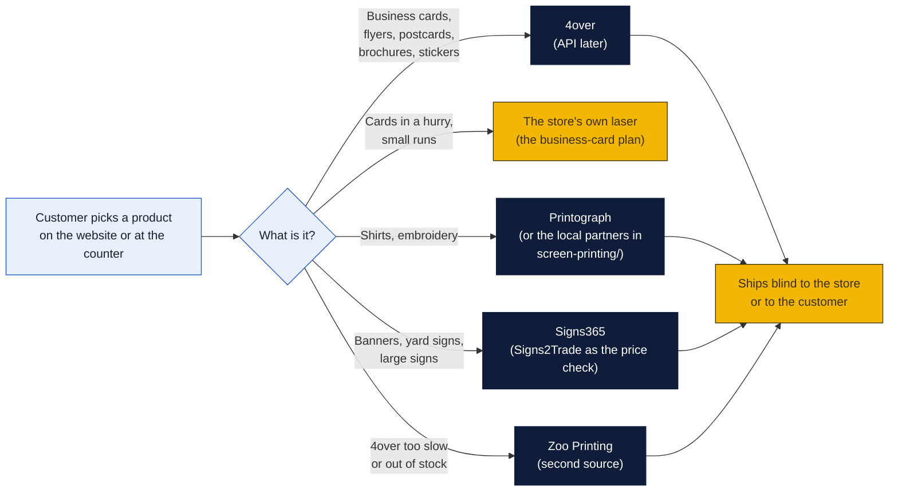
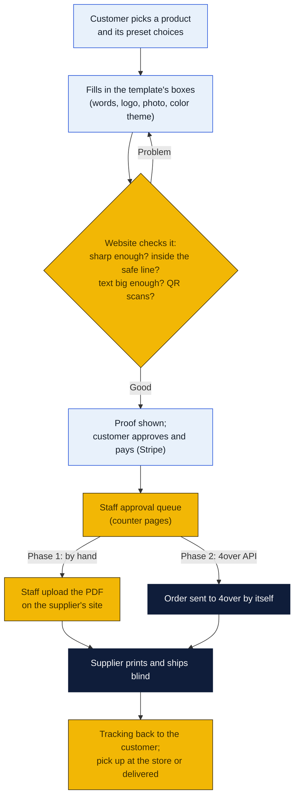

# Printing suppliers, and customers designing with presets

Written November 25, 2026, for Peter (to-do P9 in [`peter/TODO.md`](../../peter/TODO.md)). Peter: "i want to get into finding suppliers so I can start customizing the printing side of things. i need to find suppliers before i can customize that portion because i can only do what the supplier is abble to do", then the franchise's vendor list ("couple vendors the franchise uses. but i can use whatever i please"), and "i also want to be able to do a way where i can allow the customers to customize their product they are trying to make to make an order. but probably only with presets.. nothing too out of ordinary that would cause hiccups or misprints".

This widens the October plan for business cards ([`business-cards/`](../business-cards/README.md): small runs on the shop's laser, 4over for upsells and big runs, Sir Speedy for a rush) to everything the store could print, using the five vendors Goin' Postal lists for franchisees. Everything about third parties here is from public pages and forum posts found on November 25, 2026; confirm it with each vendor before relying on it.

## The short version

1. **Open free trade accounts with all five** (it costs nothing) and order each one's **sample kit**. Paper and color in hand beat any web page.
2. **4over is the best fit for the website**: the biggest catalog and a real API (a way for the website to talk to them directly), so the site can show only options 4over can make, at prices that update, and later send orders and get tracking back by itself.
3. **Printograph** (GotPrint's trade side) is the second source: business cards and postcards at trade prices, plus **embroidery and printed shirts**, blind shipping and an API for higher-volume brokers.
4. **Signs365** for banners and signs (trade-only, ships blind with no markings); **Signs2Trade** as the price check against it.
5. **Zoo Printing** as a fast second source on its core products (1 to 2 days of production), and the price check against 4over.
6. **Customers design with presets, not a free canvas**: each product is a short list of choices the supplier actually makes (size, paper, finish, quantity, turnaround) and a template whose boxes they fill in (text, a logo, a photo, one of a few colors). The website checks the file before anyone pays, the customer approves a proof, and **staff approve it before it goes to the printer**. That's what keeps misprints and reprints away.
7. **Start by hand, automate later**: the website takes the order, the money and a print-ready PDF; staff upload it on the supplier's site. Once a product sells regularly, connect 4over's API so approved orders go through by themselves.

## The five vendors

| Vendor | What they're for | Trade only? | Ships blind (no printer's name)? | API for the website? | Speed | What to ask |
|---|---|---|---|---|---|---|
| **4over** (trade printers) | Almost everything on paper: business cards, flyers, postcards, brochures, booklets, stickers, some signs; says it has over 250,000 product options | Yes, trade only | Ask (trade printers usually do) | **Yes.** REST API with a public and a private key, a test ("sandbox") mode, and calls for categories, products, options, quotes, orders, status and tracking. Needs 4over's approval and a resale certificate | Varies by product; about a week was the business-card plan's estimate | API approval steps; blind shipping and our return address on the label; local pickup or nearest plant; sample kit |
| **Printograph** (trade printers; GotPrint's business-to-business site, Burbank, CA) | Business cards, postcards, booklets, catalogs, signs, **embroidery and direct-to-garment shirts** | Yes, broker program, free to join | **Yes**, blind drop shipping (in its broker program) | **For high-volume brokers**, through an API integration | Ask | What volume unlocks the API; shirt and embroidery minimums; rewards (POG points) |
| **Zoo Printing** (trade printers; California and Kentucky) | Over 80 products; fast on its core items | Says it's a wholesale trade printer | Ask | Not found publicly; ask | **1 to 2 days of production** plus 1 to 2 days of shipping on core products (production starts when the proof is approved) | Kentucky plant shipping time to Louisiana; API; Trustpilot reviews are mixed on consistency |
| **Signs365** (banners and signs) | Banners, yard signs, rigid signs, other large-format printing | Says it's trade only | **Yes**, by resellers' reports: no markings, and the label shows the reseller as sender | Not found publicly; ask | Ask | API or order upload; sizes and materials; grommets and hems as set options |
| **Signs2Trade** (banners and signs; the trade arm of eSigns) | Banners and signs the store can't make itself | Yes (separate from its retail sister) | Ask | Not found publicly; ask | Ask | Pricing needs a login; compare with Signs365 on the same three items |

### Other options outside the franchise list

Peter (November 25): "i dont have to use their vendors.. just options i can use. im open to seeing what other options are there. and if they fit better for the website. id do it". What matters most for the website is an **API** (orders go through by themselves, prices and options stay current), then trade prices and blind shipping.

| Option | What it is | Fits the website? | Prices | Use it for |
|---|---|---|---|---|
| **Gelato** | Print-on-demand network (100+ print partners); business cards, flyers, posters, cards, apparel | **Best API of the bunch:** a test mode (sandbox), webhooks (it tells the website when an order ships) and public docs | Made for one-at-a-time orders, so higher per piece than a trade printer on big runs; free plan, Gelato+ at $29.99 a month for discounts | Posters, single prints, small runs, and as the easiest first connection to build. **Branded packaging** (paid Gelato+ plans): one 4×6 insert card and one 4×3 sticker per order with the store's design, from about $0.49 each, charged only when an order ships; only on some products and locations, so check which. The insert can bring customers back to the counter (a coupon for shipping or a mailbox) |
| **Printful** | Print-on-demand for shirts, hats, mugs and other merch, white-label | Strong API, no minimums | Per piece, higher than bulk screen printing | One-off and small merch orders; bulk shirts stay with Printograph or the local partners ([`screen-printing/`](../screen-printing/README.md)) |
| **SinaLite** | Trade-only printer (US and Canada), also custom packaging and embroidered hats | API not found publicly; ask | Trade prices; markets itself as cheaper than 4over | Price check against 4over; blind shipping with no branding or invoices in the box |
| **Smartpress** | Printer with a reseller program | No API found; orders through its website | Sales tax refunded with a resale certificate | Price check; blind shipping |
| **4OVER4** (not the same company as 4over) | Online printer with a reseller side, 1,000+ products | Ask about an API | Ask | Blind shipping to all 50 states; another price check |

**What this changes:** 4over still fits best for paper products at trade prices with an API. **Gelato** is the easiest connection to build first and the best for posters and one-off prints, at a higher cost per piece; it could run the first automated products while 4over's API approval comes through. **Printful** covers merch with no minimums. SinaLite, Smartpress and 4OVER4 go on the price sheet.

### Business cards: not on Gelato (Peter, November 25)

Gelato's premium silk business cards were $1.81 for 10 (about 18¢ a card; $1.27 on sale, $1.45 with Gelato+). Against the website's card prices (`site/src/lib/cards.ts`: 100 for $24.99, 250 for $39.99, 500 for $59.99, 1,000 for $89.99) that loses money from 250 cards up, so **business cards stay off Gelato**. The website's own designer already does the customizing; cards need a printer that takes a finished PDF by API at trade prices:

| Option | Price signal | API | Notes |
|---|---|---|---|
| **4over** | about 4¢ a card at volume (the October business-card plan) | Yes (products, options, quotes, orders, tracking; test mode) | Trade only; approval and a resale certificate |
| **Cloudprinter** | from €1.53 for 50 cards (about 3¢ a card), about 2 days of production | Yes, on every plan including the free one, with live prices and shipping | The most Gelato-like for cards (200+ print shops, no minimums); check US production and shipping to Louisiana |
| **Printograph** | trade prices | For higher-volume brokers | Later |
| **Printful** | check | Yes | Sells business card sets |
| **MOO** | retail | No public API | Ruled out |

Next: free accounts at Cloudprinter and 4over, and prices for 250 and 500 cards (16 pt, two sides) shipped to Monroe; the shop's laser keeps the quick 100 and 250 runs.

**Cloudprinter quotes Peter got (November 25, 2026; "Business card DS US L FC TNR": double-sided, US size 2 × 3.5 in, landscape, full color; 350gsm gloss board, gloss lamination both sides, square corners; shipped to Louisiana; euros, about $1.08 each):**

| Cards | Printing | Shipping | Total (about) | Per card |
|---|---|---|---|---|
| 100 | €11.22 | €6.08 to €14.92 | $18.65 to $28.20 | about 12¢ |
| 200 | €22.44 | €6.08 to €14.92 | $30.80 to $40.30 | about 12¢ (no discount at 200) |
| 500 | €53.25 | €11.66 to €12.75 | about $70 to $71 | about 11.5¢ |

(A first quote was for a 30 × 70 mm mini card on 250gsm: €2.94 for 100, which is why it looked so cheap.)

**What it means** (Peter: "my price isnt a set in stone price.. im just trying to see these products and their customizability and print on demand service"): Cloudprinter works well as a print-on-demand service (no minimums, the choices a card shop needs, an API with live prices and shipping on the free plan), but at about 11 to 12¢ a card plus shipping it fits **premium laminated cards priced to cost** (for example 100 for about $29.99 to $39.99, 500 for about $84.99 to $94.99), while everyday cards stay with the shop's laser or 4over. Still to try on Cloudprinter: no lamination, rounded corners, matte against gloss, one side against two, its file rules (bleed, safe zone, PDF type), and whether the box is plain.

### Clothing: dropship only (Peter, November 25)

Peter: "i dont want to buy a printer at all.. dropshipping only. if the customer wants the tshirt in person then they'll have to order it", and "i could use print shops nearby locally but i'd have to price them higher since they are more in demand". Business cards are on hold ("cloudprinter seems more expensive").

- **No equipment and no stock.** Walk-ins order on the website like everyone else, shipped home or to the store for pickup.
- **Printify first** (the lowest base prices, about $7 to $11 for a basic tee by reviewers' counts; many print shops to choose from, so one near Louisiana; embroidery as an add-on; an API), **Printful** as the alternative (about $11 to $18, known for consistent quality and branding: inserts, labels, packing slips; an API). Both are free to start; Printify and Printful now share a parent company. Gelato and Gooten also do shirts with an API; CustomCat's API is on its top plan only.
- **On the website, presets again:** a few shirt styles the owners choose, a color, sizes; the customer's logo or text in fixed spots (front center, left chest, back); an image-sharpness check and a mockup; the customer approves and pays, staff approve, the order goes to Printify by API, tracking comes back.
- **Bulk (12+ shirts):** a "Request a quote" button; a local shop from [`screen-printing/`](../screen-printing/README.md) (Weekend Press, Tommy's Tees, Atomic Ink) at a higher price, by hand.
- **Rush (Peter: "if i have to go local. then it'd be more for rush shipping if i need it tomorrow"):** a preset choice at checkout, "Standard, about 7 days" or "Rush, ready in 1 to 2 business days, +$X". Rush orders skip Printify and land in the staff queue marked RUSH; staff send them to a local shop (Atomic Ink in West Monroe is the plan's same-week and embroidery shop) and the customer picks up at the store. To settle with the shop first: a cutoff time (for example noon for next afternoon), which styles and print spots can be rushed, their price (for the rush add-on), and any minimum.
- **Peter's next step:** free Printify and Printful accounts; the same shirt (Bella+Canvas 3001 or Gildan 5000) priced on both with shipping to Louisiana; one sample shirt from each.

### Which one prints what (a starting plan)

## Customers customizing with presets (no misprints)

Free-form design tools are where misprints come from: tiny text, blurry photos, words cut off at the edge, colors that print darker than they look on a phone. Presets remove those mistakes before they can happen.

**1. Choices are a short list the supplier really makes.** Each product on the website is built from the supplier's own catalog (with 4over's API, the list comes straight from 4over and stays current). The customer picks from dropdowns, never types a size:

| Choice | Example for flyers |
|---|---|
| Size | 8.5 × 11, 5.5 × 8.5, 4 × 6 |
| Paper | 100 lb gloss text, 100 lb matte text |
| Sides | Front only, front and back |
| Quantity | 100, 250, 500, 1,000, 2,500 |
| Turnaround | Standard, rush (where the supplier offers it) |

The price is the supplier's cost times the store's markup, kept in a file the owners edit (like the other price files in `site/src/data/`).

**2. Templates with fixed boxes.** The customer picks a design and fills in its boxes: their words, a logo, a photo, one of a handful of color themes. They can't drag things off the edge or shrink text below a readable size. The business card designer already works this way ([`site/src/pages/cards/`](../../site/src/pages/cards/)) and is the base for the other products.

**3. The website checks the file before anyone pays:**
- **Photos and logos sharp enough** for the printed size (about 300 dots per inch), with a plain warning and a "use a sharper one" prompt if not.
- **Nothing in the cut zone:** text stays inside the safe line; backgrounds run past the edge (bleed) as the supplier asks.
- **Smallest text** at a readable size; QR codes test-scanned.
- **Colors** converted the way the printer wants, with a note that screens look brighter than paper.

**4. Two approvals:**
- **The customer approves a proof** (a picture of exactly what will print) and ticks "I checked the spelling, phone number and email".
- **Staff approve it** in a short queue on the counter pages before it goes to the printer. A quick look catches the things software can't ("this says 2025").

**5. The print-ready file** (a PDF at the supplier's size with bleed) is made by the website, so staff never resize or fix files by hand.

## What to build, in order

1. **Now, no code:** trade accounts and sample kits from all five; a price sheet for the same 6 to 8 items from each (below).
2. **First products online, by hand (phase 1):** the 3 or 4 best sellers (business cards, flyers, postcards, a banner size), each with presets from the chosen supplier, the template editor, the checks, the proof, Stripe, and the staff approval queue. Staff upload the PDF to the supplier.
3. **4over's API (phase 2):** once orders come regularly. Ask 4over for API keys (a reseller certificate is needed), try it in their test mode, then: the product list and prices synced from 4over, approved orders sent automatically, and status and tracking brought back to the order.
4. **More products** as each sells: stickers, door hangers, yard signs, shirts (Printograph or the local partners).

The ideas waiting in P7 (the full-screen card editor, a free sample pack, request a quote) fit into steps 2 and 4.

## The price sheet to fill in

Ask each vendor for the same items, delivered to Monroe, so the numbers compare (add SinaLite, Smartpress, 4OVER4 and Gelato as extra columns if their prices look close):

| Item | 4over | Printograph | Zoo Printing | Signs365 | Signs2Trade |
|---|---|---|---|---|---|
| 500 business cards, 16 pt matte, 2 sides | | | | n/a | n/a |
| 1,000 business cards, 16 pt gloss, 2 sides | | | | n/a | n/a |
| 250 flyers 8.5 × 11, 100 lb gloss, 1 side | | | | n/a | n/a |
| 500 postcards 4 × 6, 2 sides | | | | n/a | n/a |
| 100 stickers 3 × 3 | | | | | |
| 1 vinyl banner 3 × 6 ft, grommets | | | | | |
| 10 yard signs 18 × 24, with stakes | | | | | |
| Shipping to Monroe (ground) | | | | | |
| Production days | | | | | |
| Blind shipping, and our name as sender? | | | | | |
| API? | | | | | |

## Questions for every vendor

- Is blind shipping included, and can the label show **Goin' Postal Forsythe** as the sender?
- What files do you want (PDF version, bleed size, color setting), and do you check files before printing?
- What happens on a misprint: reprint, credit, and how fast?
- Which plant ships to Louisiana, and how long is ground shipping?
- Is there an **API**, or at least an order upload? What does it take to get access?
- Can you send a **sample kit**, and a price list we can see before ordering?
- Any franchise pricing for Goin' Postal stores?

## Decisions for Peter and Rin

1. **Open all five trade accounts and order sample kits?** (Free; a week or two.)
2. **The first products online:** business cards, flyers, postcards and one banner size, or a different starting set?
3. **4over as the main supplier with its API later,** with Printograph, Signs365 and Zoo Printing for what 4over doesn't do best? Or **start automated with Gelato** (easiest connection, higher cost per piece) while 4over's API approval comes through?
4. **Staff approval before every order goes to the printer?** (Recommended; it's the last guard against misprints.)
5. **Shipping:** to the store for pickup (the customer comes back in, maybe buys something else), straight to the customer, or both?
6. **Markup:** the same percentage on everything, or set per product once the price sheet is filled in?

## Sources

Found November 25, 2026; vendors' terms change, so confirm with each one.

- 4over and its API: [OnPrintShop's 4over integration guide](https://docs.onprintshop.com/third-party-integrations/4over-integration), [how to implement the 4over API](https://docs.onprintshop.com/third-party-integrations/how-to-implement-4over-api), [PRINTING United Alliance on the 4over API solution](https://www.printing.org/content/2022/10/10/onprintshop-launches-updated-and-fully-integrated-4over-api-solution), [4over's blog: 5 ways 4over helps you sell](https://blog.4over.com/5-ways-4over-helps-you-sell), [a 4over API client (keys, sandbox and live)](https://packagist.org/packages/arturnawrot/4over-api-client), [a WooCommerce plugin's 4over API code (products, quotes, orders, status, tracking)](https://github.com/saurabhd/woocommerce-4over/blob/master/4over/4over-api.php), [a 4over Shopify integration guide (approval and reseller certificate)](https://www.printxpand.com/blog/4over-shopify-integration/), [Order Desk's 4over integration](https://help.orderdesk.com/integration-setup-guides/print-on-demand/4over-integration), [TMS FileMaker 4over API (api-users.4over.com)](http://tms.us/FileMaker/4Over/)
- Printograph: [Printograph sign-up](https://www.printograph.com/user/join), [Printograph login for brokers](https://www.printograph.com/user/login), [GotPrint: 8 reasons to join our print brokers program](https://blog.gotprint.com/gp-insider/8-reasons-why-you-should-join-our-print-brokers-program/), [Crunchbase profile](https://www.crunchbase.com/organization/printograph-inc)
- Zoo Printing: [Zoo Printing labels page](https://www.zooprinting.com/products/labels), [LinkedIn](https://www.linkedin.com/company/zoo-printing), [Trustpilot reviews](https://www.trustpilot.com/review/zooprinting.com), [PrintPlanet thread](https://printplanet.com/threads/zoo-printing-w2p.10140/)
- Signs365: [Signs101: what is Signs365?](https://www.signs101.com/threads/what-is-signs365.167657), [Signs101: dropshipping](https://signs101.com/threads/dropshipping.147473), [Signs101: Signs 365 my new go-to for banners](https://www.signs101.com/threads/signs-365-my-new-go-to-for-banners.135551), [PrintPlanet: banners quote surprise](https://printplanet.com/threads/banners-quote-surprise.294581)
- Signs2Trade: [Signs101 thread with a Signs2Trade representative](https://signs101.com/threads/signs2trade.135210/post-1306796), [Signs101: Signs2Trade photo examples](https://signs101.com/threads/signs2trade-photo-examples.130925)
- Gelato branded packaging: [branded packaging](https://www.gelato.com/branded-packaging), [custom packaging](https://www.gelato.com/custom-packaging), [do you offer custom or branded packaging](https://support.gelato.com/en/articles/8996268-do-you-offer-custom-or-branded-packaging), [insert and label sizes](https://support.gelato.com/en/articles/8996258-what-are-the-size-and-shape-of-packaging-inserts-and-branded-labels), [one insert and one label per order](https://support.gelato.com/en/articles/8996257-can-i-include-multiple-packaging-inserts-or-multiple-branded-labels-in-the-same-order)
- Business cards by API: [Cloudprinter business cards](https://www.cloudprinter.com/products/business-cards), [Cloudprinter print API](https://www.cloudprinter.com/print-api), [Cloudprinter plans](https://www.cloudprinter.com/service-and-print-api-levels), [Cloudprinter home](https://www.cloudprinter.com/), [Printful business cards](https://www.printful.com/ca/business-cards), [API Evangelist on MOO (no public API)](https://providers.apievangelist.com/providers/moo/), [APIs.io on MOO](https://apis.io/providers/moo/)
- Clothing: [Bootstrapping Ecommerce: best print-on-demand t-shirt companies](https://bootstrappingecommerce.com/best-print-on-demand-t-shirt-companies/), [Printify vs Gelato (Printify's page)](https://printify.com/printify-vs-gelato), [WiserReview: Printful alternatives tested](https://wiserreview.com/blog/printful-alternatives/), [Podbase: cheapest print on demand](https://www.podbase.com/blogs/cheapest-print-on-demand), [Ecommerce Platforms: Printful alternatives](https://ecommerce-platforms.com/print-on-demand/printful-alternatives), [Custom Ink: what print-on-demand shirts really cost](https://www.customink.com/blog/print-on-demand-shirts-what-it-really-costs/)
- Outside the franchise list: [SinaLite about (trade-only, blind shipping, no branding)](https://sinalite.com/en_us/about), [SinaLite vs 4over offer page](https://offers.sinalite.com/better-than-4over/), [Gelato printing service and print API](https://gelato.com/printing-service), [Gelato API terms](https://gelato.com/en-US/legal/api-terms/), [Gelato pricing](https://www.gelato.com/resources/pricing), [Printful API](https://www.printful.com/de/api), [Smartpress print reseller program](https://smartpress.com/pages/print-reseller-program), [4OVER4 blind shipping](https://v2.4over4.com/benefit/blind-shipping)
- Blind shipping in general: [PrintKEG: white label, blind and drop shipping](https://www.printkeg.com/blogs/tips/blind-shipping-drop-shipping-prints), [Wikipedia: trade printing](https://en.wikipedia.org/wiki/Trade_printing)
